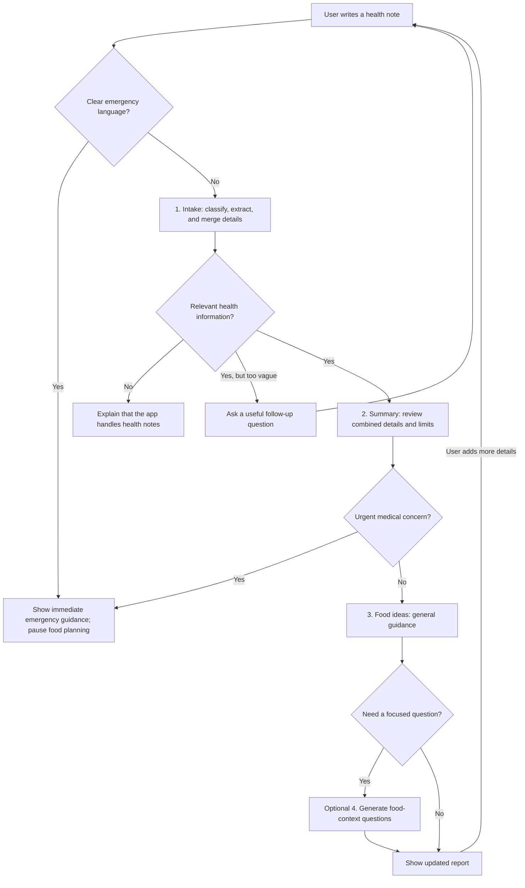

# Health Notes

A conversational health-notes app. Describe symptoms, habits, and any readings you
have in ordinary language; the app organizes those details, gives a cautious
health review, and suggests general food ideas. You can add information later in
the same conversation, and the report updates using the combined details.

[Try the live app](https://health-notes-web.vercel.app)

Built with Next.js, React, TypeScript, LangChain JavaScript, and Groq. OpenRouter
and Hugging Face are optional providers for later workflow stages. The browser
talks to a Next.js backend; API keys stay on the server, not in browser code.

**Important:** This is a learning project, not a medical diagnosis, treatment
plan, or dependable emergency service. Do not use it instead of professional care.

## Start on your computer

From a clone of this repository in PowerShell (Node.js 22 or newer):

```powershell
npm install
npm run setup
npm run dev
```

Open **http://127.0.0.1:3000** in your browser.

This app uses Node.js/npm. You do not need `uv run` or Python virtual-environment
activation to run it. Stop the local server with **Ctrl+C**.

### What setup does

`npm run setup` creates an ignored `.env.local`. It reuses `GROQ_API_KEY` from
the parent Python project's `.env` if available, generates a random checkpoint
signing secret, and disables optional LangSmith tracing. It never prints keys
or overwrites an existing `.env.local`.

If there is no valid existing Groq key, open `.env.local` in your editor
and replace only the `GROQ_API_KEY` placeholder with your key. Restart the server
after changing environment variables. Do not paste API keys into chat or commit
the file. If a key was previously exposed, replace it with a newly rotated key.

Required settings:

```dotenv
GROQ_API_KEY=your_actual_key
GROQ_MODEL=openai/gpt-oss-20b
WORKFLOW_STATE_SECRET=a_random_secret_at_least_32_characters_long
LANGSMITH_TRACING=false
LANGCHAIN_TRACING_V2=false
```

The setup command generates the signing secret for you. No Gemini key is needed.

Optional settings in the same `.env.local` file:

```dotenv
OPENROUTER_API_KEY=
OPENROUTER_MODEL=openai/gpt-oss-20b
HF_TOKEN=
HF_MODEL=Qwen/Qwen3.8-27B:cerebras
```

With an OpenRouter key, summaries move to OpenRouter, excluding Groq as an
upstream provider. With a Hugging Face token, food ideas and optional questions
move to Hugging Face's Cerebras-hosted model. Empty optional tokens leave those
stages on Groq. Add both keys to reduce a normal report from three Groq calls
to one, then restart the dev server. If Hugging Face runs out of credits, hits a
rate limit or cannot be reached, those food steps fall back to OpenRouter when
its key is configured; they do not fall back to Groq. These services have their own quotas and
charges. The Hugging Face token needs Inference Providers permission. Review
each provider's privacy terms before sending real health notes.

## Try the app

1. Select **Try a fictional example**, or write your own health note.
2. Acknowledge that submitted health text is sent to Groq and, when configured,
   OpenRouter and Hugging Face.
3. Submit the note. The progress steps are Organize, Understand and Food ideas;
   a fourth question step runs only when Food ideas needs a useful follow-up.
4. Explore **Summary**, **Readings** and **Food ideas** in the report panel.
5. Click a question or suggestion in a report tab to bring an editable answer
   starter into the conversation. On mobile, this switches to Conversation.
6. Download a JSON report if you want to keep it. **New report** clears the current
   conversation and results.

Useful checks to try:

- `How are you?` → friendly scope response, without a health summary.
- `I have a health concern.` → asks for more details.
- `I have felt tired for three days, but I have no measurements.` → a limited
  symptoms summary and general food suggestions.
- Answer a question such as `How long?` with `Three days` → uses the pending
  health question to understand the reply.
- `I am 24 and drink 4 litres of water daily.` → a cautious review of that
  habit and its limits, plus focused questions.
- Add `BP is 120` and then `Hemoglobin is 12.4 g/dL` in the same session →
  keeps both details and rebuilds all report sections.
- `I am dying` → immediate emergency guidance and no food-planning call. This
  is a narrow safeguard, not a complete emergency detector.

## How the workflow works



There are normally three server-controlled requests to `POST /api/health`:

1. **Intake:** classify the latest reply, extract new details, merge them with
   previously verified details, and check evidence against source messages. Measurements are
   optional. Off-topic messages receive a friendly response; vague or conflicting
   health details produce a follow-up question.
2. **Summary:** review what the combined details may mean, explain limits and
   next steps, and make explicit urgent-care/specialist-diet decisions. An added
   unit that was never supplied triggers a grounded rewrite before display.
3. **Diet:** suggest general food habits or an illustrative sample day when there
   is sufficient adult and dietary context. Unclear or complex restrictions lead
   to review guidance instead of a guessed menu. Urgent concerns prevent this call.

An optional fourth request writes focused Food ideas questions when the diet
step leaves them empty. Every accepted follow-up rebuilds the review and food
guidance using the combined context; the tabs change together when the full
new report is ready. Clear first-person emergency language is handled before
any provider call. The app shows country-labelled emergency links while that text
is being typed, even before the consent checkbox is checked.

Provider routing is configurable: intake uses Groq; summaries use OpenRouter
when configured, otherwise Groq; food ideas and optional questions use Hugging
Face when configured, otherwise Groq. Certain Hugging Face failures can fall
back to OpenRouter if its key is available. This splits requests across provider
quotas, but it does not remove rate limits or guarantee an answer.

Each stage uses a separate system prompt and runtime-validated schema. The
Groq path uses LangChain's `prompt.pipe(structuredModel)`, the JavaScript
equivalent of Python's `prompt | structured_llm`. The optional providers use
their OpenAI-compatible JSON-schema APIs, followed by the same local validation.

If a provider returns malformed structured data, that stage receives at most one JSON
repair attempt. Required safety decisions never receive invented defaults.
If a later request fails, **Retry this step** resumes from the last known completed
stage rather than repeating extraction. Token-limit errors show a retry countdown.
Very large messages may need a shorter report, more provider quota or a later retry.

## Where the context lives

The current tab holds the conversation, report and a signed checkpoint in React
memory. The backend verifies that checkpoint on each follow-up or stage request.
The checkpoint expires after 30 minutes without a successful update. It is signed
against tampering, not encrypted or proof that self-reported facts are medically
correct. It is sent only in the request body, never in a URL.

There is no database or automatic saving of health text to local storage.
Only the light/dark appearance choice is stored there. Refreshing or closing the
page resets the temporary health state. Separate tabs have independent reports.
The server has no global conversation store. Clearing a report removes it from
the application's current memory; it does not delete provider-side records.

The app does not log raw health text, keys, checkpoints or complete model responses.
Groq, OpenRouter and Hugging Face process submitted information when their
respective stages are configured. Do not enable external
prompt tracing for sensitive health information without reviewing its implications.

## Important limits

This is an educational prototype, not a clinically validated diagnostic, treatment
or emergency-screening system. The model can omit or misinterpret facts and can
misclassify input. Evidence checks reduce unsupported extraction but cannot prove
medical correctness. System instructions do not guarantee protection against prompt
injection. Always review measurements, units, food restrictions and medical concerns.

General food ideas are not a personalized medical diet. The model is instructed to
respect allergies and restrictions, but the output and ingredients still need human
review. The explicit blood-pressure guard is only one safeguard and is not an
exhaustive way to identify emergencies. Seek medical care for severe or sudden
symptoms instead of waiting for an app response.

Sources informing the prompts, not browsed by the model during each run:

- [MedlinePlus: understanding lab results](https://medlineplus.gov/lab-tests/how-to-understand-your-lab-results/)
- [WHO: healthy diet](https://www.who.int/health-topics/healthy-diet)
- [American Heart Association: very high blood pressure](https://www.heart.org/en/health-topics/high-blood-pressure/understanding-blood-pressure-readings/when-to-call-911-for-high-blood-pressure)
- [American Heart Association: when to call emergency services](https://www.heart.org/en/health-topics/house-calls/when-to-call-911)
- [Bangladesh Police: national emergency service 999](https://telecom-police.portal.gov.bd/pages/static-pages/695e3b0cc4774958d7b72321)
- [US 911.gov: calling 911](https://www.911.gov/calling-911/)
- [UK NHS: when to call 999](https://www.nhs.uk/nhs-services/urgent-and-emergency-care-services/when-to-call-999/)
- [NIDDK: kidney disease and nutrition](https://www.niddk.nih.gov/health-information/kidney-disease/chronic-kidney-disease-ckd/healthy-eating-adults-chronic-kidney-disease)

## Checks and production build

```powershell
npm test
npm run typecheck
npm run build
npm run verify:build
npm start
```

The automated tests use fake responses and do not consume API tokens. Optional
live checks below use only fictional information and consume the configured
providers' quotas.
Run them from a second terminal while the app is running:

```powershell
node scripts/smoke.mjs measurements
node scripts/smoke.mjs conversation
node scripts/smoke.mjs scope
node scripts/smoke.mjs large
node scripts/smoke.mjs review
node scripts/smoke.mjs followup
node scripts/smoke.mjs emergency
```

The live checker can wait briefly and retry the unfinished step when the provider
returns a short rate-limit delay. It prints status and counts; the review and
followup cases also print only fictional generated review text. It never prints
the API key or checkpoint.

## GitHub and Vercel deployment

Production is live at [health-notes-web.vercel.app](https://health-notes-web.vercel.app).
This repository contains the Next.js app at its root. Its `main` branch is
connected to the existing `health-notes-web` Vercel project with Root Directory
`./`. Pushing an app change to `main` should trigger a production deployment;
the Next.js UI and `/api/health` backend deploy together. Production API keys
and `WORKFLOW_STATE_SECRET` belong in Vercel's hidden server-side environment
variables. Never commit `.env.local` or put secrets in `NEXT_PUBLIC_` variables.

Public visitors use the owner's provider quotas and may incur charges. Before
sharing broadly, add server-side rate limiting for `POST /api/health`, set
provider spending limits, and test the deployment with fictional information.
One report normally uses three provider requests; repairs and focused questions
can add more. No database or separate Python service is required for this version.

Official deployment references:

- [Next.js on Vercel](https://vercel.com/docs/frameworks/full-stack/nextjs)
- [Vercel API rate limiting](https://vercel.com/kb/guide/add-rate-limiting-vercel)
- [Groq structured outputs](https://console.groq.com/docs/structured-outputs)
- [OpenRouter provider routing](https://openrouter.ai/docs/guides/routing/provider-selection)
- [Hugging Face structured outputs](https://huggingface.co/docs/inference-providers/guides/structured-output)

## Main files to learn from

| File | Role |
| --- | --- |
| `src/components/health-app.tsx` | Conversation UI, temporary state and sequential requests |
| `src/components/health-report.tsx` | Report sections and JSON download |
| `src/app/api/health/route.ts` | Backend entrypoint and bounded request validation |
| `src/lib/server/workflow.ts` | Routing, three normal stages and optional questions |
| `src/lib/server/prompts.ts` | System messages for the workflow |
| `src/lib/server/merge.ts` | Preserve verified facts across follow-ups |
| `src/lib/emergency.ts` | Immediate distress language safeguard |
| `src/lib/server/model.ts` | LangChain/Groq extraction and provider selection |
| `src/lib/server/compatible-model.ts` | OpenRouter and Hugging Face JSON-schema calls |
| `src/lib/schemas.ts` | The expected input/output shapes |
| `src/lib/server/checkpoint.ts` | Signed context carried between requests |
| `src/app/globals.css` | Visual design and responsive layout |

